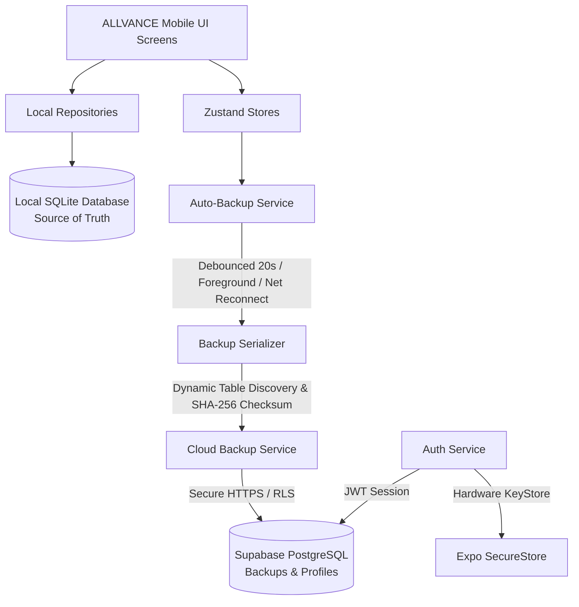

# ALLVANCE

> **Your Personal Growth Ecosystem**  
> *Personal All-in-One Android Productivity, Placement, and Learning Application*

---

## 📱 Application Identity & Philosophy

- **Application Name**: ALLVANCE
- **Tagline**: Your Personal Growth Ecosystem
- **Target Platform**: Android (Cross-platform compatible via React Native & Expo)
- **Use Case**: Personal productivity, placement mastery, technical interview preparation, and engineering growth
- **Architecture**: **Offline-First with Seamless Cloud Synchronization**.
  - Local SQLite is the single source of truth for all active operations.
  - Zero cloud dependencies required to launch, navigate, or operate the app.
  - Complete Guest Mode support: account creation is optional.
  - Encrypted, checksum-verified cloud backup and restore powered by Supabase.
- **Design System**: Premium Dark and Light modes with centralized design tokens and system preference detection.

---

## 🛠️ Technology Stack

| Layer | Technology | Purpose |
|---|---|---|
| **Runtime & Framework** | React Native (0.88+) & Expo (SDK 58) | High-performance mobile runtime on Android |
| **Language** | TypeScript (Strict mode) | 100% type-safe codebase across all modules |
| **Routing & Navigation** | Expo Router (v4, File-based) | Tab and stack navigation with native animations |
| **Local Database** | SQLite (`expo-sqlite`) | High-speed local relational database with WAL mode & foreign key enforcement |
| **ORM** | Drizzle ORM (`drizzle-orm`) | Type-safe schema definitions, relationships, and queries |
| **Cloud & Auth** | Supabase (`@supabase/supabase-js`) | User authentication (email/password) & PostgreSQL cloud backup storage |
| **Credential Storage** | Expo SecureStore (`expo-secure-store`) | Hardware-backed keystore/keychain for auth tokens and sessions |
| **Integrity & Hashing** | Expo Crypto (`expo-crypto`) | Cryptographic SHA-256 checksum calculation for backup payloads |
| **Network Detection** | Expo Network (`expo-network`) | Cellular/Wi-Fi connection detection for offline handling & backup auto-sync |
| **State Management** | Zustand (v5) with AsyncStorage persist | Theme preferences, auth state, backup status, and offline caches |
| **Forms & Validation** | React Hook Form & Zod | Form handling with schema-driven validation |
| **Icons & Design Tokens** | Lucide React Native & Custom Tokens | Cohesive, minimal design language |

---

## 🏗️ Architecture: Offline-First + Cloud Backup



### Core Architecture Rules:
1. **SQLite is King**: Active app read and write operations execute exclusively against the local SQLite database. The app launches and functions at full speed without internet connectivity.
2. **Dynamic Snapshotting**: The backup serializer introspects `sqlite_master` at runtime, discovering all user tables without brittle hardcoded table name lists.
3. **Payload Integrity**: Every backup payload contains:
   - Complete table row data
   - Database schema migration version
   - Application version and timestamp
   - Device model, platform, and persistent device ID
   - Cryptographic SHA-256 checksum for tamper-proof verification
4. **Safe Transactional Restore**:
   - Creates an in-memory safety snapshot before modifying local state.
   - Disables foreign keys during restoration and re-enables them post-import.
   - Validates foreign key constraints (`PRAGMA foreign_key_check`).
   - If any step fails, automatically rolls back to the pre-restore snapshot.
5. **Smart Background Sync**:
   - Debounces auto-backups (20 seconds) after meaningful database mutations.
   - Triggers sync automatically when the app returns to the foreground (`AppState` change).
   - Re-attempts pending backups when network connectivity is restored (`expo-network`).
   - Implements exponential backoff retry queues for transient network drops.

---

## 🔐 Authentication & Security

- **Supported Auth Modes**:
  - **Account Mode**: Email & Password sign-up with email verification and secure session persistence.
  - **Guest Mode**: Full offline access without registration or login prompts.
- **Credential Storage**: Sensitive authentication tokens (`access_token`, `refresh_token`) are stored in hardware-backed storage via `expo-secure-store`. Passwords are never stored anywhere in SQLite, AsyncStorage, or application logs.
- **Password Recovery**: Complete forgot-password flow with reset email dispatch and in-app password update.
- **Account Management**:
  - Live profile viewing and name editing.
  - Cloud backup listing, manual backup generation, and selective snapshot restoration.
  - Safe sign-out with local session clearing and SecureStore token purge.
  - Complete account deletion via secure Supabase RPC (`delete_user_account()`), which cascades and purges all user profiles and cloud backups before removing the auth identity.
- **Row Level Security (RLS)**:
  - Every table in Supabase enforces PostgreSQL RLS policies (`auth.uid() = id` or `auth.uid() = user_id`).
  - Users can never query, inspect, or modify backups belonging to another user.

---

## ⚡ Supabase Setup & Configuration

### Step 1: Create a Supabase Project
1. Log in to [Supabase](https://supabase.com) and create a new project.
2. Navigate to **Project Settings** -> **API** to retrieve:
   - **Project URL**
   - **anon / public key**

### Step 2: Apply the Database Migration Script
1. In your Supabase dashboard, open the **SQL Editor**.
2. Open the file [`supabase/migrations/20261105000000_allvance_auth_and_backups.sql`](supabase/migrations/20261105000000_allvance_auth_and_backups.sql) from this repository.
3. Paste the contents into the SQL Editor and click **Run**.
4. This creates:
   - `public.user_profiles` table with automatic `handle_new_user()` trigger.
   - `public.user_backups` table with indexed `user_id`, `created_at`, payload JSONB, and SHA-256 checksum columns.
   - Granular RLS policies for `SELECT`, `INSERT`, `UPDATE`, and `DELETE`.
   - Security definer stored procedure `public.delete_user_account()`.

### Step 3: Configure Environment Variables
Copy `.env.example` to `.env` in the project root:

```bash
cp .env.example .env
```

Edit `.env` and fill in your actual Supabase credentials:
```env
EXPO_PUBLIC_SUPABASE_URL=https://your-project-id.supabase.co
EXPO_PUBLIC_SUPABASE_ANON_KEY=eyJhbGciOiJIUzI1NiIsInR5cCI6IkpXVCJ9...
```

*Note: Environment variables prefixed with `EXPO_PUBLIC_` are safely bundled by Expo at build time. Never place your `service_role` secret in this file or the mobile app.*

---

## 📂 Project Structure

```
ALLVANCE/
├── assets/                  # App icons, splash screens, and adaptive Android icons
├── supabase/
│   └── migrations/          # Supabase PostgreSQL migrations (RLS, tables, triggers)
├── src/
│   ├── app/                 # Expo Router routes (Tabs, Auth, Modules)
│   │   ├── (auth)/          # Authentication Stack
│   │   │   ├── _layout.tsx  # Auth Stack navigator
│   │   │   ├── welcome.tsx  # Welcome & branding screen (Guest / Sign Up / Login)
│   │   │   ├── login.tsx    # Email/password login with remember option
│   │   │   ├── signup.tsx   # Account registration with terms & validation
│   │   │   ├── forgot-password.tsx # Password recovery email request
│   │   │   └── reset-password.tsx  # Deep-link password update screen
│   │   ├── (tabs)/          # 5 Main Bottom Tabs:
│   │   │   ├── _layout.tsx  # Tab layout configuration with Lucide icons
│   │   │   ├── index.tsx    # Home Tab (DashboardScreen)
│   │   │   ├── placement.tsx# Placement Ecosystem Tab
│   │   │   ├── practice.tsx # Practice Arena Tab (DSA, SQL, Aptitude, Interviews)
│   │   │   ├── ai.tsx       # AI Assistant Tab
│   │   │   └── more.tsx     # More Tab (Searchable grid of all 15 modules)
│   │   ├── _layout.tsx      # Root Stack Layout, Auth Guard & Database init
│   │   ├── account.tsx      # Account Settings & Cloud Backup Management Screen
│   │   ├── placement.tsx    # 1. Placement Tracker (Phase 1)
│   │   ├── dsa.tsx          # 2. DSA Practice (Phase 2)
│   │   ├── resume.tsx       # 3. Resume Builder (Phase 3)
│   │   ├── interviews.tsx   # 4. Interview Preparation (Phase 4)
│   │   ├── sql.tsx          # 5. SQL Studio
│   │   ├── aptitude.tsx     # 6. Aptitude & Reasoning
│   │   ├── companies.tsx    # 7. Company Directory
│   │   ├── projects.tsx     # 8. Project Portfolio
│   │   ├── planner.tsx      # 9. Study Planner
│   │   ├── knowledge.tsx    # 10. Knowledge Vault
│   │   ├── ai.tsx           # 11. AI Assistant
│   │   ├── analytics.tsx    # 12. Analytics & Insights
│   │   ├── skills.tsx       # 13. Skills Matrix
│   │   ├── personal.tsx     # 14. Personal Manager
│   │   └── settings.tsx     # 15. Settings & Database Tools
│   ├── components/          # Reusable UI component library (30+ components)
│   ├── constants/           # Module registry and app constants
│   ├── database/            # SQLite & Drizzle ORM layer
│   │   ├── client.ts        # Database connection singleton & PRAGMA configuration
│   │   ├── schema/          # Drizzle ORM table schemas (All modules)
│   │   ├── migrations/      # Versioned migration runner (Migrations 1 to 5)
│   │   ├── repositories/    # Strongly-typed repository pattern
│   │   └── seed/            # Seed data (Interviews, DSA, Settings, etc.)
│   ├── features/            # Feature-specific implementations
│   │   ├── placement/       # Placement Tracker logic & UI
│   │   ├── dsa/             # DSA Tracker logic & UI
│   │   ├── resume/          # Resume Builder logic & UI
│   │   └── interviews/      # Phase 4 Interview Preparation logic & UI
│   ├── hooks/               # Custom React hooks (useAppTheme, etc.)
│   ├── services/            # Core business & infrastructure services
│   │   ├── supabase/        # Supabase client, SecureStore adapter, Auth service
│   │   ├── backup/          # Dynamic SQLite serializer, Cloud backup, Auto-backup service
│   │   └── storage/         # Local file & storage utilities
│   ├── store/               # Zustand state stores (useAuthStore, useBackupStore, useThemeStore)
│   ├── theme/               # Centralized design tokens (colors, typography, spacing, shadows)
│   ├── types/               # Global TypeScript definitions
│   └── utils/               # Helpers & icon mapper
├── app.json                 # Expo configuration
├── package.json             # Dependencies and scripts
├── tsconfig.json            # Strict TypeScript configuration
└── README.md
```

---

## 🎨 Theme System

The design system is built around a centralized token architecture:
- **Dark Mode**: Premium deep slate background (`#090D16`), rich surface cards (`#0F172A`), and vibrant sky blue accent (`#38BDF8`).
- **Light Mode**: Crisp slate background (`#F8FAFC`), pure white surface (`#FFFFFF`), and deep ocean blue accent (`#0284C7`).
- **System Default**: Automatically reacts to device dark/light appearance changes.
- **Persistence**: Selected theme is saved instantly using Zustand and AsyncStorage.
- **Live Switcher**: Easily toggle themes via the top header bar icon or inside Settings.

---

## 🚀 Running on Android

### Prerequisites
- Node.js (v18 or higher recommended; v24 installed)
- Android device with **Expo Go** app installed, OR an Android Studio Emulator running

### Step 1: Install Dependencies
```bash
npm install
```

### Step 2: Configure Environment
Ensure `.env` contains your Supabase project parameters (or use default mock keys for offline-only testing).

### Step 3: Start the Expo Development Server
```bash
npx expo start
```
*Or directly start targeting Android:*
```bash
npm run android
```

### Step 4: Run on Your Device
1. **Physical Android Device**:
   - Install **Expo Go** from the Google Play Store.
   - Scan the QR code displayed in the terminal using the Expo Go camera/scanner.
2. **Android Studio Emulator**:
   - Start an Android Virtual Device (AVD) from Android Studio.
   - Press `a` in the terminal to launch directly onto the emulator.

---

## 🧪 Quality Assurance & Verification

The project is kept under strict quality gates:

```bash
# 1. Typecheck: Verify 0 TypeScript errors across all modules
npx tsc --noEmit

# 2. Linting: Verify zero ESLint errors and warnings
npx expo lint

# 3. Native Bundle Check: Verify Hermes Android bundle exports cleanly
npx expo export --platform android
```

---

## 🛑 Implementation Status

- **Phase 0 (Application Foundation)**: **COMPLETE**
- **Phase 1 (Placement Management Module)**: **COMPLETE**
- **Phase 2 (DSA Tracker Module)**: **COMPLETE**
- **Phase 3 (Resume Builder Module)**: **COMPLETE**
- **Phase 4 (Interview Preparation Module)**: **COMPLETE**
- **Authentication & Cloud Backup Integration**: **COMPLETE**
  - Supabase Auth (Sign In, Sign Up, Password Recovery, Guest Mode)
  - Expo SecureStore session persistence
  - Dynamic SQLite serialization & SHA-256 integrity check
  - Auto-backup scheduler (debouncing, foreground, network retry)
  - Safe transactional restore with rollback protection
  - Account settings & cloud snapshot management
- Next Phase: Phase 5 (To be initiated upon user instruction).
